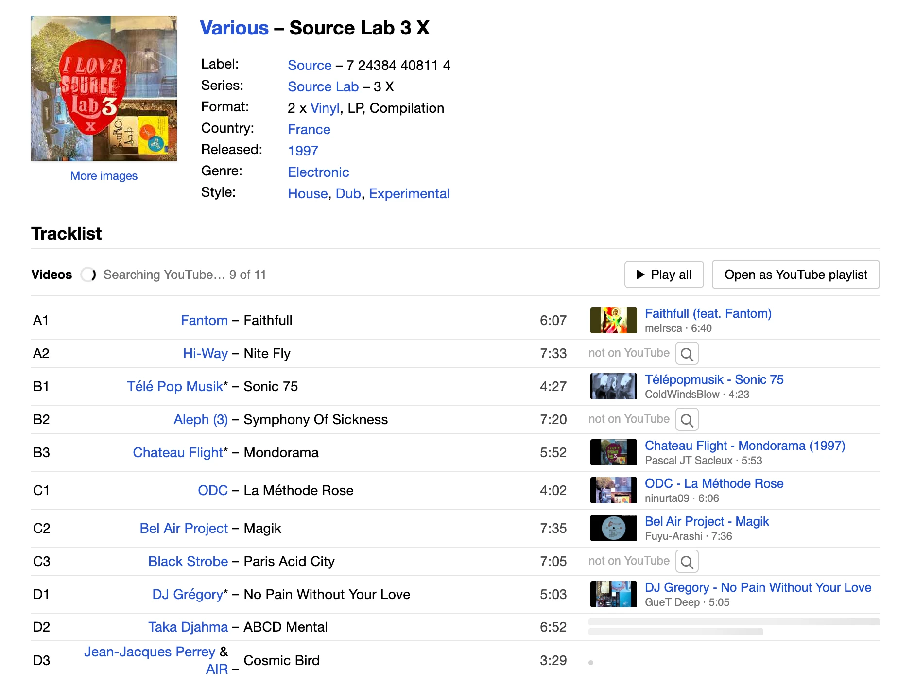

# Tracklist Videos for Discogs



A Chrome extension that finds every track of a Discogs release on YouTube, shows each match in the tracklist, and plays the whole record.

Open a release or master page on [Discogs](https://www.discogs.com) and press **Find tracks on YouTube** above the tracklist. Each row fills in as its search finishes, with the best upload's thumbnail, title, channel and length. When the search is done you can:

- **Click a track** to play it in a small player at the bottom right of the page.
- **Play all** to play the record track after track. The player moves to the next track when a video ends, and has previous and next buttons.
- **Switch uploads:** the thumbnails under the video are other uploads of the same track. A `+N` in the tracklist shows how many there are.
- **Open as YouTube playlist** to open every match as one unsaved playlist on YouTube.
- **Search YouTube yourself** with the magnifier next to any track that wasn't found, which opens a YouTube search for the artist and title.

Nothing runs until you press the button. Results are kept for the rest of the browser session, so going back to a release shows them straight away.

## Installing

The extension isn't in the Chrome Web Store, so it's installed as an unpacked extension. This works in Chrome, Brave, Edge and Arc.

1. Download the release zip and unzip it. Keep the folder somewhere permanent: Chrome runs the extension from it.
2. Open `chrome://extensions` and turn on **Developer mode** (top right).
3. Click **Load unpacked** and choose the unzipped folder (the one containing `manifest.json`).
4. Open any Discogs release, for example [this one](https://www.discogs.com/release/1998249), and press **Find tracks on YouTube**.

Chrome may sometimes ask whether to disable developer-mode extensions. Choose to keep it.

To update, unzip the new version over the old folder and press the reload arrow on the extension's card in `chrome://extensions`.

## How matching works

Tracklists are often typed by hand, and uploads are titled however the uploader liked, so the extension is strict about what it accepts. A track with no confident match shows **not on YouTube** rather than a guess.

For each track:

1. **Track details:** the artist and title come from the public Discogs API, with each artist as credited on the release. Discogs' `(2)` numbering is removed from artist names. Tracks without their own artist use the release's artist.
2. **Search:** YouTube Music's song catalogue is searched first, then its video index.
3. **Choosing:** a YouTube matcher scores the results on artist, title, version (remix, edit, live and so on) and channel, and picks the best credible upload. Before it chooses, two checks remove look-alikes:
   - **Word order:** the title's words must appear in the same order. "The Next Step Is Love" isn't "Love Is".
   - **Whole names:** the artist must be named as whole words in the title, channel or credited artist. "Danny Bond" isn't "Danny B".
4. **Alternatives:** the matcher is asked again without each pick, giving up to six uploads per track, best first.
5. **Spelling fallback:** only when nothing matches, the same results are tried with other spellings:
   - **Artist without "The":** "The Holy Ghost" is often uploaded as "Holy Ghost".
   - **Main Discogs name:** used when the release credits the artist under a different name (shown with `*` on Discogs).
   - **Title one letter off:** an upload by the artist with the same title, spelt one letter differently in one word. "Marie Teresa" on Discogs, "Maria Teresa" on YouTube. Words under four letters and single-word titles are never respelt.

Tracks are searched one at a time, with a short pause between them, to keep the load on YouTube low.

## Permissions and privacy

The extension collects nothing and has no server of its own. It talks only to Discogs and YouTube.

| Permission | Why |
| --- | --- |
| `https://www.discogs.com/*` (content script) | Adds the button, matches and player to Discogs pages. |
| `https://api.discogs.com/*` | Reads the release's tracklist from the public Discogs API. |
| `https://music.youtube.com/*`, `https://www.youtube.com/*` | Searches YouTube Music. Videos play in YouTube's standard embedded player. |
| `storage` | Keeps finished results for the browser session only (`chrome.storage.session`). |
| `declarativeNetRequestWithHostAccess` | YouTube Music only answers search requests that come from its own site. One session rule sets `Origin` and `Referer` on the extension's own search requests. It applies only to the extension's background worker, never to pages you browse. |

## Building

The build bundles the TypeScript sources with Vite into two scripts: `dist/background.js`, the service worker that fetches tracklists and runs the searches, and `dist/content.js`, the script added to Discogs pages. Both are minified and obfuscated, with no source maps.

The YouTube Music search and matcher (`videoSearch.ts` and `videoSearchRequest.ts`, imported as `youtube-search/…`) aren't in this repository, so the extension can't be built from it alone. A git-ignored `build.local.json` beside `build.mjs` says where they are on your machine, and where a pnpm store holding Vite and javascript-obfuscator is:

```json
{
  "search": "path/to/the/search/module",
  "store": "path/to/node_modules/.pnpm"
}
```

Relative paths are read from this folder. The search module's own imports, such as youtubei.js, resolve from its own location.

With Node 24 or newer:

```bash
node build.mjs     # builds dist/
node package.mjs   # builds dist/, then zips it into release/
```

`package.mjs` writes `release/Tracklist-Videos-for-Discogs-<version>.zip`, containing one folder ready for **Load unpacked**, with `INSTALL.txt` inside. The version comes from `manifest.json`.

To try a build locally, load this folder itself with **Load unpacked**, and press the reload arrow on the extension's card after each rebuild.

## Project layout

```
manifest.json            Extension manifest (Manifest V3)
build.mjs                Vite build: minified, obfuscated, no source maps
build.local.json         Local paths for the build (git-ignored, not in the repository)
package.mjs              Build, then zip for sharing
INSTALL.txt              Install steps shipped inside the zip
src/
  types.ts               Messages and shapes shared by the worker and the page
  background/
    index.ts             Service worker: streams a lookup to the page, caches results
    discogs.ts           Reads a release or master from the Discogs API
    headers.ts           Session rule for YouTube Music's origin check
    match.ts             Runs the search and the matcher for one track
    matchRules.ts        Word-order and whole-name checks
    respell.ts           Other spellings of the artist and title
  content/
    index.ts             Finds the tracklist, follows Discogs' in-page navigation
    toolbar.ts           The bar above the tracklist
    rows.ts              The match cell on each track row
    player.ts            The floating player and Play all
    dom.ts               Small DOM helpers
    style.css            Styles, all prefixed dtv- to stay clear of Discogs' own
```

Tracklist Videos for Discogs isn't made by or affiliated with Discogs or YouTube.
